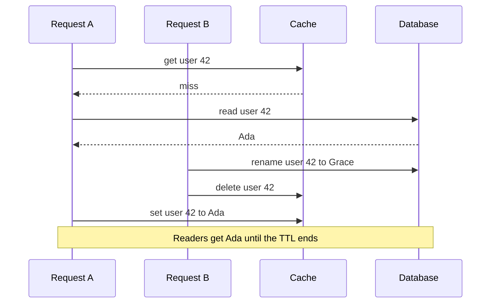
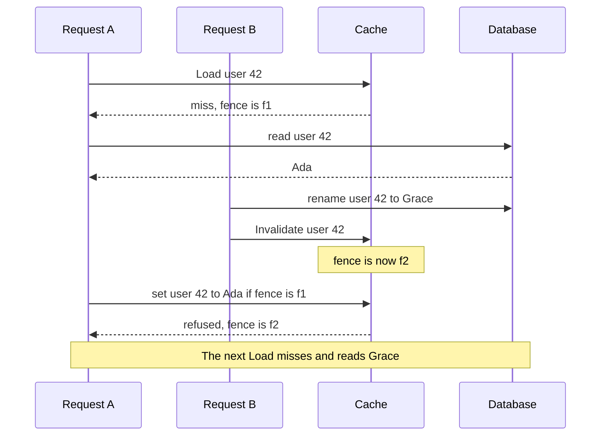

# cascache

cascache is a read-through cache for Go. It caches values loaded from a
database or another slow source. Once you invalidate a key, a load that was
already running cannot put the old value back. It works in one process, or
across processes that share invalidations through Redis.

## Why

With a plain cache, a read that misses loads the value from the database and
writes it to the cache. An update writes the database and deletes the cached
key. If a slow read loads the old value before an update and writes it after
the delete, the cache serves that stale value until its TTL ends.

cascache gives each key a token called a fence. `Load` reads the fence before
it calls your loader and stores the result only if the fence is unchanged.
`Invalidate` replaces the fence. Values stored under the old fence are no longer
served, and loads that started earlier cannot store their results.

With a plain cache:



With cascache:



## Features

- Concurrent `Load` calls for the same key in one process share a single loader
  run.
- `Load` returns the loaded value even when a cache read or write fails.
- Backends for one process, for Redis, and for values kept in each process with
  invalidations shared through Redis.
- Value stores for Ristretto, BigCache and Redis.
- Codecs for JSON, CBOR, msgpack and protobuf.
- Typed keys, randomized TTLs and metrics callbacks in the `typed` package.
- Load timeouts, loader panic recovery and an `Observer` for cache events.

## Install

```sh
go get github.com/unkn0wn-root/cascache/v4
```

cascache needs Go 1.23.1 or later. Version 4 changed the module path, API and
storage format, so it does not share cached data or invalidations with v3.

## Quick start

This program caches users in a Ristretto store inside the process:

```go
package main

import (
	"context"
	"fmt"
	"log"
	"time"

	"github.com/unkn0wn-root/cascache/v4"
	"github.com/unkn0wn-root/cascache/v4/backend"
	"github.com/unkn0wn-root/cascache/v4/codec"
	"github.com/unkn0wn-root/cascache/v4/provider/ristretto"
)

type User struct {
	ID   string
	Name string
}

func main() {
	if err := run(); err != nil {
		log.Fatal(err)
	}
}

func run() error {
	ctx := context.Background()

	store, err := ristretto.New(ristretto.Config{
		NumCounters: 200_000, // about 10 times the entries it holds
		MaxCost:     1 << 20, // about 18,000 entries: Ristretto adds 56 to each entry's cost of 1
		BufferItems: 64,
	})
	if err != nil {
		return err
	}
	defer store.Close(ctx)

	b, err := backend.NewLocal(store, backend.LocalOptions{})
	if err != nil {
		return err
	}
	defer b.Close()

	cache, err := cascache.New(cascache.Options[User]{
		Namespace:  "users",
		Backend:    b,
		Codec:      codec.JSON[User]{},
		DefaultTTL: 5 * time.Minute,
	})
	if err != nil {
		return err
	}

	user, err := cache.Load(ctx, "42", func(context.Context) (User, error) {
		return User{ID: "42", Name: "Ada"}, nil // read your database here
	})
	if err != nil {
		return err
	}

	fmt.Println(user.Name)
	return nil
}
```

On a hit, `Load` returns the cached value. On a miss, it calls your loader and
caches the result. If the cache read or write fails, you still get the loaded
value, and the error goes to `Options.OnLoad` and `Options.Observer`.

## Updating data

Write the change to the source first, then call `Invalidate`. In the other
order, a load that starts between the two calls can read the old data and cache
it again.

```go
if err := db.UpdateUser(ctx, user); err != nil {
	return err
}
if err := cache.Invalidate(ctx, user.ID); err != nil {
	return err
}
```

If `Invalidate` returns an error, the old value may still be served, so retry
it. A service that writes the data but never reads the cache can use
`cascache.NewInvalidator` with the same namespace and a `redisbackend.New`
backend on the same Redis. It needs no value type or codec.

## Sharing a cache across processes

`backend/redis` has two backends:

- `New` keeps values and invalidations in Redis. A value one process loads is
  served to all of them.
- `NewShared` keeps values in each process's own store and only invalidations
  in Redis. Each process loads and holds its own copy.

go-redis and `backend/redis` are both named `redis`, so rename them on import:

```go
import (
	goredis "github.com/redis/go-redis/v9"
	redisbackend "github.com/unkn0wn-root/cascache/v4/backend/redis"
)

client := goredis.NewClient(&goredis.Options{Addr: "localhost:6379"})
defer client.Close()

b, err := redisbackend.NewShared(store, client, redisbackend.Options{})
if err != nil {
	return err
}
```

The Redis backends have no `Close` method, so drop `defer b.Close()` from the
quick start.

Point the client at the Redis primary. A replica that lags behind may not have
an invalidation yet, and cascache would serve the old value as current. `New`
and `NewShared` return `ErrReplicaReads` for a Cluster client with `ReadOnly`
set. They do not detect a Sentinel client with `ReplicaOnly` set, or other
clients that read from replicas. The
[package docs](https://pkg.go.dev/github.com/unkn0wn-root/cascache/v4/backend/redis)
list the go-redis settings to leave off.

Redis copies writes to replicas in the background, and cascache does not wait
for them. If the primary fails right after an invalidation, the new primary may
not have it, and the old value can be served again until it expires.

## Typed keys

The `typed` package takes keys of any comparable type, such as an `int64` ID.
It can also give each value a random TTL within a range, so entries written
together do not all expire at once:

```go
users, err := typed.New(typed.Options[int64, User]{
	Config: typed.Config{
		Namespace: "users",
		MaxTTL:    10 * time.Minute,
		MinTTL:    8 * time.Minute,
		Jitter:    1, // pick each TTL at random between MinTTL and MaxTTL
	},
	KeyFunc: func(id int64) string { return strconv.FormatInt(id, 10) },
	Codec:   codec.JSON[User]{},
	Backend: b,
})
```

## Documentation

The full reference is on [pkg.go.dev](https://pkg.go.dev/github.com/unkn0wn-root/cascache/v4). It also covers:

- [Cache.Snapshot](https://pkg.go.dev/github.com/unkn0wn-root/cascache/v4#Cache.Snapshot) and [Cache.Set](https://pkg.go.dev/github.com/unkn0wn-root/cascache/v4#Cache.Set) to fill the cache yourself
- [Options.LoadTimeout](https://pkg.go.dev/github.com/unkn0wn-root/cascache/v4#Options.LoadTimeout) to limit how long a loader runs
- [Observer](https://pkg.go.dev/github.com/unkn0wn-root/cascache/v4#Observer) for cache events, with [hooks/slog](https://pkg.go.dev/github.com/unkn0wn-root/cascache/v4/hooks/slog) to log them and [hooks/async](https://pkg.go.dev/github.com/unkn0wn-root/cascache/v4/hooks/async) to handle them in the background
- [backend.Backend](https://pkg.go.dev/github.com/unkn0wn-root/cascache/v4/backend#Backend) and [backend/backendtest](https://pkg.go.dev/github.com/unkn0wn-root/cascache/v4/backend/backendtest) to write and test your own backend
- Value stores for [Ristretto](https://pkg.go.dev/github.com/unkn0wn-root/cascache/v4/provider/ristretto), [BigCache](https://pkg.go.dev/github.com/unkn0wn-root/cascache/v4/provider/bigcache) and [Redis](https://pkg.go.dev/github.com/unkn0wn-root/cascache/v4/provider/redis). The Redis store holds values only and does not share invalidations the way `backend/redis` does.

[_benchmarks/README.md](_benchmarks/README.md) explains how to run the
benchmarks, and [CHANGELOG.md](CHANGELOG.md) lists the changes in each release.

## License

Apache 2.0. See [LICENSE](LICENSE).
